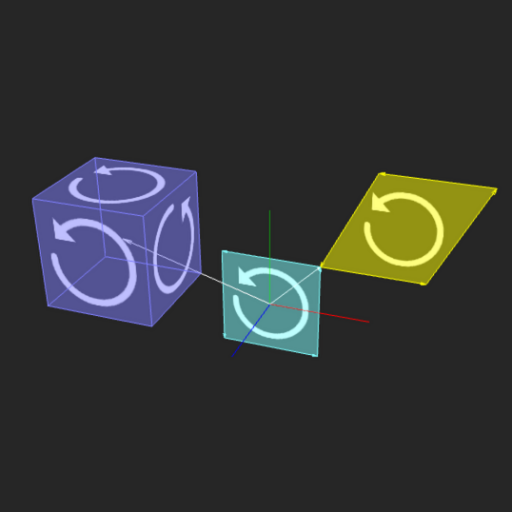
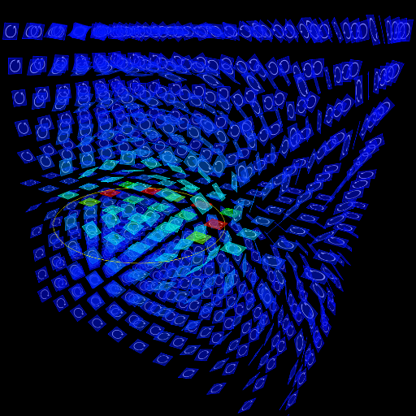
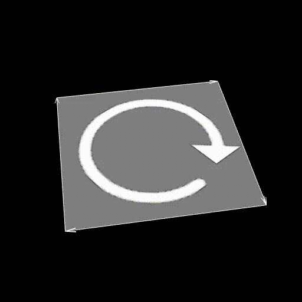


## Mathplay project

**by sunny.P**  
Mathematical code that allows you to visualize (Vanilla) Geometric Algebra ,Written in Kotlin by |Noobs| so plz don't kill me if I code anything stupid (tho, plz feel free to point them out)  
this project used [kool-engine](https://github.com/kool-engine/kool) so if you interested; consider check it too!

**Syntax**  
start define your Multivector using

```kotlin
val a = Multivector(s=1.0, x=1.0, y=1.0, z=1.0, xy=1.0, yz=1.0, zx=1.0, xyz=1.0)
```


Then you could start doing operation by

```kotlin
     a.grade(n) //n = 0,1,2 and/or 3
     a.getGrade()
     a.reverse()
     a+b
     a-b
     a*b
     a*s //s is Double
     a/s
     a.outer(b)
     a.inner(b) // use Hestenes's inner product
     a.leftCon(b)
     a.rightCon(b)  
```

There are 2 built-in constants
*I* (xyz=1.0) and *zero* (all components = 0.0)



**Visualize**  
Inside Staged.kt  find

```kotlin
    ctx.scenes += scene {
        mainRenderPass.clearColor = ClearColorFill(Color.BLACK) //whatever color you want
	    defaultOrbitCamera()
	    updateTransparentOrdering()
	    defaultStage()
	    //write all visualize code here
    }
```

use these function to display desired object

```kotlin
     scalarDraw
     vectorDraw(a,zero,Color.LIGHT_GRAY)
     bivectorDraw(a)
     biFromVector(a,b,zero, Color.CYAN)
     trivectorDraw(a)
     triFromVector(a,b,c)
```

There is function to draw Multiple objects at each point at once

```kotlin
     fun Path(t: Double): Multivector {
         return Multivector(x = cos(t), y = 0.0, z = sin(t)) //setting path
     }

     drawPath({t -> Path(t)},0.0,2*PI)

drawField(
    xMin = -2.0, xMax = 2.0,
    yMin = -2.0, yMax = 2.0,
    zMin = -2.0, zMax = 0.0,
    space = 0.4, scale = 0.2,
    picture = pic, picture2 = pic2,
    vector = false, bivector = true, trivector = false,
    fieldFunc = { P -> Magnetic(P, { t -> Path(t) }, 0.0, 2 * PI) }
)
```



You could also do animation

```kotlin     
     val transientNodes = mutableListOf<Node>()
     var t = 0.0
     onUpdate {
         transientNodes.forEach {
             removeNode(it)
             it.release()
         }
         transientNodes.clear()
         transparentFaces.clear()
         val permanentNodeCount = children.size
         
         //start from here
         t += 0.5 * Time.deltaT.toDouble()
         val rotor = Multivector(cos(t)) + blade * sin(t)
         val v1_prime = rotor.reverse() * v1 * rotor
         val v2_prime = rotor.reverse() * v2 * rotor
         biFromVector(v1_prime, v2_prime, -0.5 * (v1_prime + v2_prime), picture = pic, picture2 = pic2)
         

         //DON'T touch anything below
         for (i in permanentNodeCount until children.size) {
             transientNodes.add(children[i])
         }
     }
```

